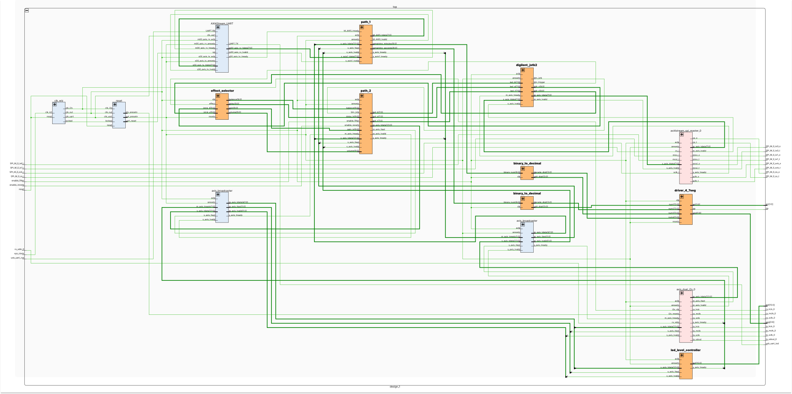
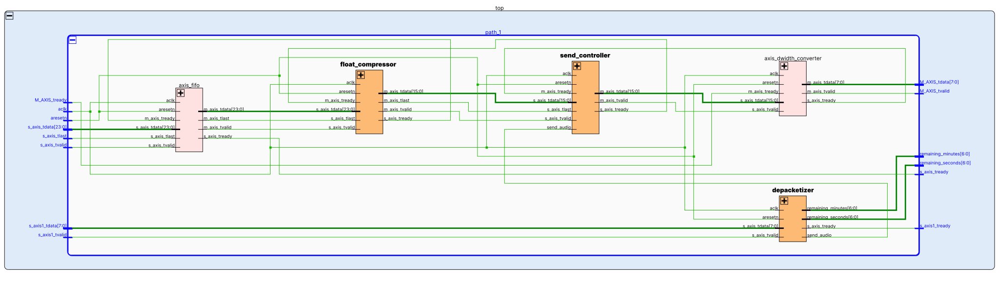
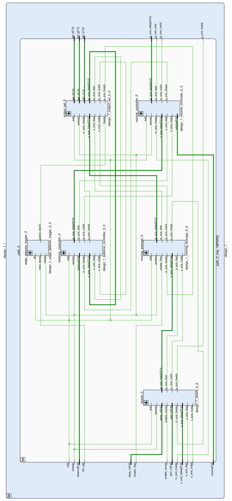

<div align="center">


# AXIngale

*A real-time audio effects processor with joystick control on the Digilent Basys-3 FPGA.*

*Course: Digital Electronics Systems Design @ PoliMi* \
*Group members: [jonnysciar](https://github.com/jonnysciar), [gmnapo](https://github.com/gmnapo), [damianopasquini02](https://github.com/damianopasquini02), Rin* \
*Academic year: 2025–2026*

</div>

## Table of Contents

1. [Project Overview](#project-overview)
2. [System Architecture](#system-architecture)
3. [Building the Vivado Project](#building-the-vivado-project)
4. [Module Reference](#module-reference)
   - [Path 1 — UART-Controlled Audio Acquisition](#path-1--uart-controlled-audio-acquisition)
   - [Path 2 — Real-Time Audio Processing](#path-2--real-time-audio-processing)
   - [Shared Infrastructure](#shared-infrastructure)
5. [Known Bugs](#known-bugs)
6. [Acknowledgements](#acknowledgements)

## Project Overview

This project implements a dual-path real-time audio processing system on an FPGA, using the Digilent **Pmod I2S2** as audio source/sink and the Digilent **Pmod JSTK2** as a joystick controller. The two processing paths run concurrently on the same audio stream and share a common AXI4-Stream (AXIS) infrastructure:

- **Path 1** receives timed recording commands from a PC over UART, compresses the audio into a custom 16-bit floating-point format, and streams it back to the PC.
- **Path 2** applies real-time effects (reverb, moving-average low-pass filter, channel mixing, volume, and balance) controlled interactively by the joystick and on-board switches, and drives a VU-meter on the board's LEDs.

Both paths share the same I2S audio input. Path 1 drives the 7-segment display (countdown timer) and the UART link; Path 2 drives the I2S output, the LED level meter, and the JSTK2 RGB LED.

## System Architecture



**Block diagram legend:**
 
| Color | Meaning |
|:---:|---|
|  | Custom modules available in this repository |
|  | IP cores provided by Vivado (no source needed) |
|  | Licence-protected modules — not included in this repository |


## Building the Vivado Project

### Prerequisites

- Vivado 2020.2
- Digilent board files installed (for Basys-3 support)
- A Basys-3 board, with Pmod JSTK2 and Pmod I2S2 peripherals

### Steps

1. **Clone the repository**

2. **Source Vivado**

3. **Makefile targets**

   ```bash
   make                # synthesise, implement, and generate the bitstream (default)
   make record t=10    # run the Python recording script for 10 seconds
   make clean          # remove all build artefacts
   ```

4. **Program the FPGA** \
   Connect the Basys-3 board to the PC via the USB-JTAG Cable. \
   Enter *Vivado HW Manager* and program the FPGA with the .bit file generated in the folder: \
   `<REPO_PATH>/build/<PRJ_NAME>.runs/impl_1/`

## Module Reference

### Path 1 — UART-Controlled Audio Acquisition

Path 1 lets a PC start and stop timed audio recordings. Commands arrive over UART; compressed audio is streamed back over UART.



##### FLOAT COMPRESSOR
> Compresses signed 24-bit PCM samples into a custom 16-bit `[S(1) | EXP(4) | MANTISSA(11)]` floating-point format to reduce UART bandwidth, with all field widths configurable via generics.
 
---

##### SEND CONTROLLER
> Gates the compressed AXIS stream toward the UART TX when `send_audio = 1`, discarding all transactions otherwise while correctly tracking `TLAST`-delimited packet boundaries.

---

##### DEPACKETIZER
 
> Parses 4-byte UART packets (`HEADER=0x69 | MIN | SEC | FOOTER=0x42`) and drives the acquisition FSM — asserting `send_audio` and loading the countdown on valid commands, silently discarding malformed, out-of-range, or mid-recording packets (except the `0x00 0x00` stop command).

---

### Path 2 — Real-Time Audio Processing

Path 2 is the live effects chain. Audio flows left to right through the modules below:



**Controls:**
 
| Control | Source |
|---|---|
| Enable moving average | SW0 |
| Enable reverb | SW1 |
| REVERB alpha / REVERB delay | JSTK X/Y when TRIG=1 |
| BALANCE / VOLUME | JSTK X/Y when TRIG=0 |
| Cycle OUTPUT SELECTOR mode | Rising edge of JSTK BTN |

##### REVERB
> Implements per-channel feedback delay (`y[n] = sat(x[n] + gain·y[n−delay])`) with joystick-controlled gain and delay depth, where `sat()` performs the same saturating clip used by VOLUME.

---

##### BALANCE
> Attenuates the left channel when the joystick is pushed right and the right channel when pushed left, using the same exponential law as VOLUME.

---

##### MOVING AVERAGE
> Applies a 32-tap moving-average low-pass filter when `enable_filter` is high, and passes samples through unmodified when low.

---

##### OUTPUT SELECTOR
> Cycles through eight stereo channel-mixing modes (normal, mute, mono-left, mono-right, sum, difference, and cross combinations) on each rising edge of `btn_jstk`, reflecting the active mode on the JSTK2 RGB LED.

---

##### VOLUME
> Applies an exponential gain (doubling every `2^N` joystick units, generic `N = 6`) centred at the joystick midpoint, with saturating output to prevent wrapping.

### Shared Infrastructure

##### 7-SEGMENT DRIVER
> Multiplexes the four `MM:SS` countdown digits onto the Basys-3 7-segment display by rapidly cycling the active-low anode select (`AN[3:0]`) and segment cathode (`SEG[6:0]`) outputs fast enough for persistence of vision.

---

##### DIGILENT JSTK2
> Bridges the Pmod JSTK2 over an AXI4-Stream SPI master, exposing `jstk_x[9:0]`, `jstk_y[9:0]`, `btn_jstk`, and `btn_trigger` as outputs while accepting `led_r/g/b[7:0]` to drive the joystick's RGB LED.

---

##### EFFECT SELECTOR
> Demultiplexes the joystick axes based on `btn_trigger`: when high, X/Y control reverb alpha and delay; when low, X/Y control balance and volume — with the inactive pair latched at its last value.

---

##### LED LEVEL CONTROLLER
> Averages the left and right channel magnitudes and drives the 16 on-board LEDs as a logarithmic VU-meter, with no LEDs lit below magnitude 28 and all 16 lit at saturation (224).

---

##### AXI4-STREAM (AXIS) Handshake
> All modules communicate over standard AXI4-Stream (`TDATA`, `TVALID`, `TREADY`, `TLAST`) using an FSM-based handshake that does not require one transaction per clock cycle.

## Known Bugs

- Resetting the board during runtime causes the Pmod JSTK2 to become unresponsive.

## Acknowledgments

We would like to thank the professors and teaching assistants of the **Digital Electronic System Design** course at Politecnico di Milano for designing this project track and for their guidance throughout the semester.
 


